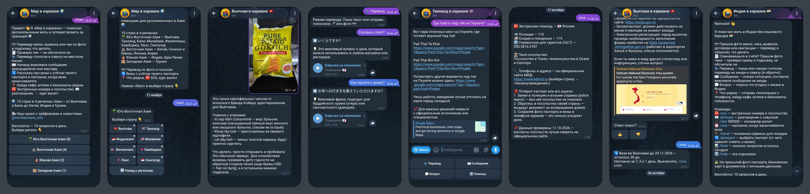
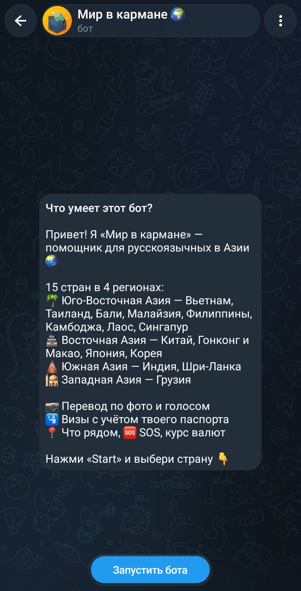
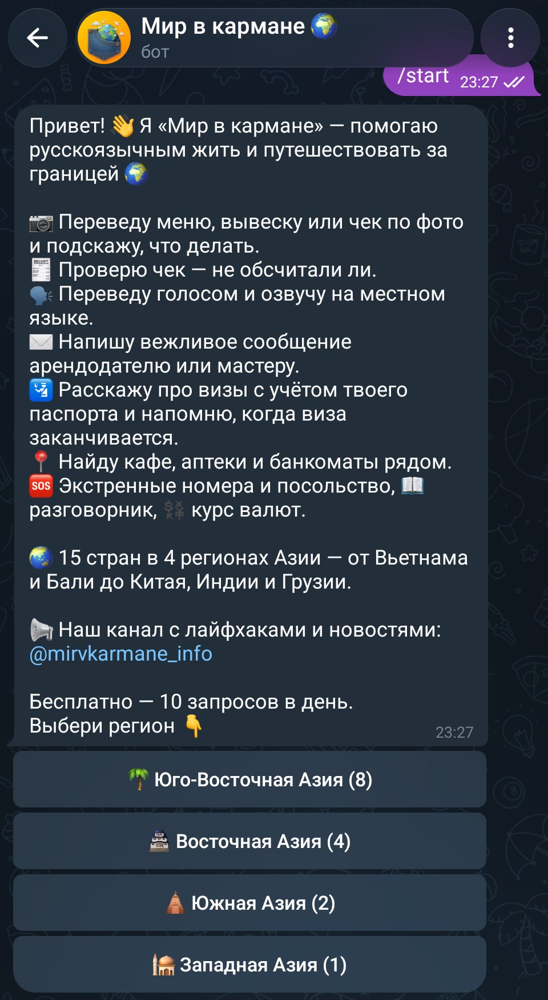
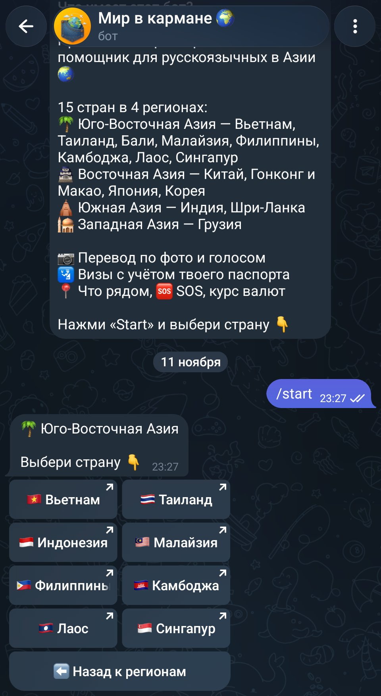
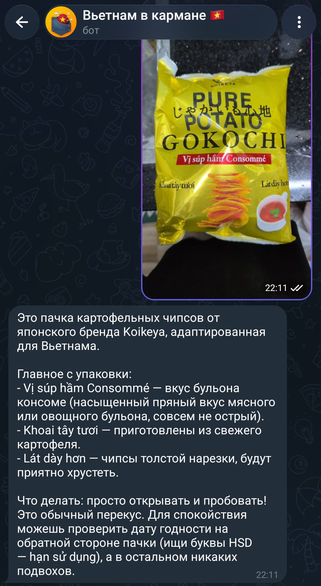
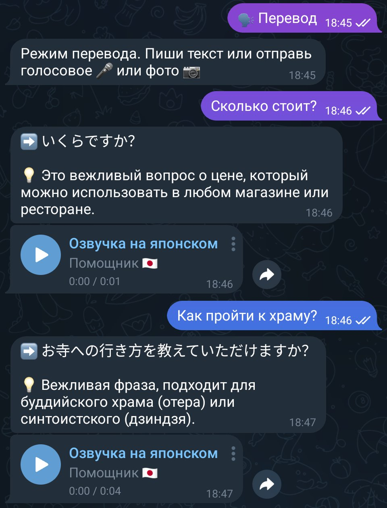
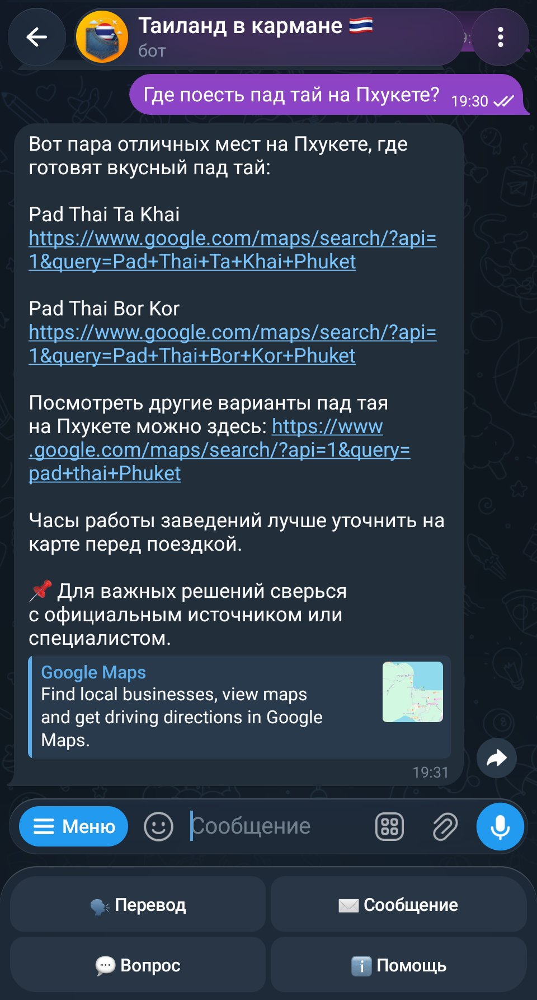
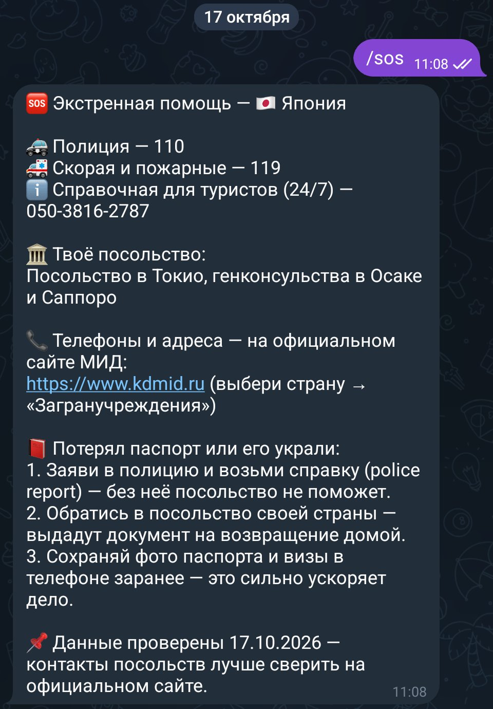
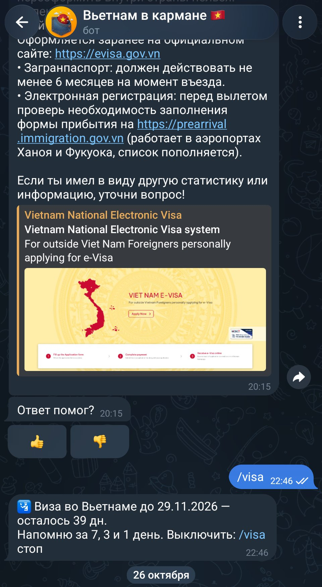
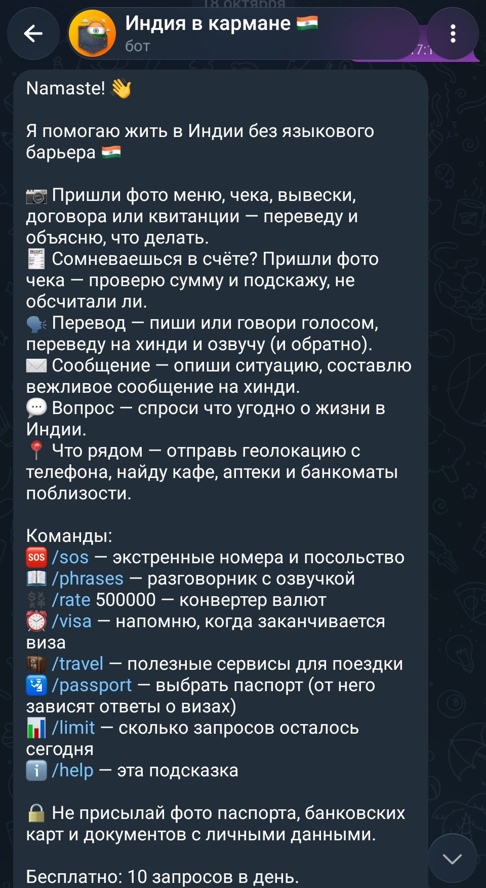

<h1 align="center">Мир в кармане · сеть Telegram-ботов</h1>

  ИИ-помощник для русскоязычных туристов, зимовщиков и релокантов в Азии: 
  перевод по фото и голосом, визы с учётом паспорта, SOS, «что рядом» и ответы о жизни в стране.

  <b>Telegram</b> · главный бот + 15 ботов стран · 4 региона · подписка через Telegram Stars

  

> Исходный код хранится в закрытом репозитории. Здесь витрина проекта. Код могу показать по запросу.
> Попробовать: [@mirvkarmane_bot](https://t.me/mirvkarmane_bot) · канал с лайфхаками: [@mirvkarmane_info](https://t.me/mirvkarmane_info)

---

## Зачем

За границей мешают языковой барьер, незнакомые приложения, визы, бюрократия и риск переплатить. «Мир в кармане» работает как знакомый, который давно живёт в стране: переведёт меню, проверит чек, напишет вежливое сообщение арендодателю и подскажет, куда звонить в экстренной ситуации.

## Как устроена сеть

Главный бот **@mirvkarmane_bot** показывает меню из 4 регионов и ведёт в бот нужной страны. У каждой страны свой бот со своей базой знаний, разговорником и экстренными номерами, а лимиты и подписка общие для всех ботов.

| Регион | Страны |
|---|---|
| 🌴 Юго-Восточная Азия | Вьетнам, Таиланд, Индонезия (Бали), Малайзия, Филиппины, Камбоджа, Лаос, Сингапур |
| 🏯 Восточная Азия | Китай, Гонконг и Макао, Япония, Южная Корея |
| 🛕 Южная Азия | Индия, Шри-Ланка |
| 🕌 Западная Азия | Грузия |

## Что умеет

| Функция | Как работает |
|---|---|
| **Перевод по фото** | меню, вывески, упаковки, договоры, квитанции — перевод и объяснение, что делать |
| **Проверка чека** | сверяет сумму и подсказывает, не обсчитали ли |
| **Перевод текста и голоса** | на местный язык и обратно, с озвучкой и подсказкой, когда фраза уместна |
| **Вежливые сообщения** | арендодателю, мастеру, в отель — на местном языке |
| **Визы с учётом паспорта** | Россия, Казахстан, Беларусь, Украина, Узбекистан; ссылки на официальные сайты |
| **/visa** | напоминание за 7, 3 и 1 день до окончания визы |
| **Что рядом** | кафе, аптеки и банкоматы по геолокации, со ссылками на карты |
| **/sos** | экстренные номера, посольство и что делать при потере паспорта |
| **/phrases, /rate** | разговорник с озвучкой и конвертер валют |
| **/travel** | проверенные сервисы: eSIM, страховка, трансфер, билеты, отели, экскурсии |
| **Вопросы о жизни** | база проверенных фактов по стране + поиск свежей информации |

## Экраны

### Знакомство и выбор страны

| О боте | Старт и регионы | Страны региона |
|---|---|---|
|  |  |  |

### Перевод

| Фото упаковки, Вьетнам | Фразы с озвучкой, Япония |
|---|---|
|  |  |

### Помощь на месте

| Где поесть, Таиланд | SOS, Япония | Визы и напоминание, Вьетнам |
|---|---|---|
|  |  |  |

### Команды

## Монетизация

- **Бесплатно:** 10 запросов в день, общий лимит на все боты.
- **Подписка** через Telegram Stars: от недели до года, до 100 запросов в день во всех странах.
- **Партнёрские ссылки** (Travelpayouts, с маркировкой рекламы): eSIM, страховка, трансфер, авиабилеты, отели, экскурсии. Показываются, только когда вопрос касается темы.

## Надёжность и безопасность

- Боты работают 24/7 на собственном сервере.
- Токены и ключи хранятся вне кода, в переменных окружения.
- Бот предупреждает не присылать фото паспорта и банковских карт.
- В ответах о визах и законах — ссылки на официальные источники и напоминание сверяться с ними; контакты в /sos помечены датой проверки.

## Что сделала

- придумала продукт и структуру сети: главный бот, боты стран, общие лимиты и подписка;
- собрала базы знаний по 15 странам: визы, экстренные номера, местные приложения, такси;
- написала ботов на Python, подключила ИИ для перевода, распознавания фото и голоса;
- настроила подписку через Telegram Stars и партнёрские ссылки;
- развернула ботов на сервере для работы 24/7.

Разработка велась в паре с ИИ-ассистентом: постановка задач, проверка результата, тестирование и доводка — на мне.

## Связанный проект

[World in Pocket](https://github.com/irinamedovnikova345-ui/world-in-pocket) — мобильное приложение, выросшее из этих ботов.

---

**Автор:** Ирина Медовникова · связь: worldinpocket.help@gmail.com
